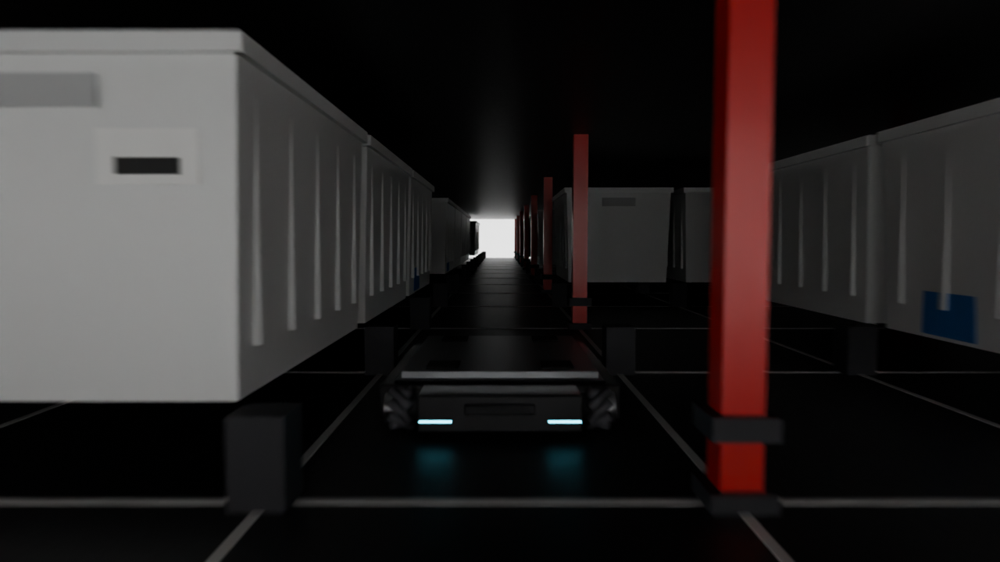

# AutoStore 시뮬레이션 — Claude × Blender × Unity 사실적 렌더링 테스트

AutoStore 방식 큐브 스토리지(그리드 + 적층 빈 + 상부 주행 로봇 + 포트)를 조사해 모델링하고, 같은 시뮬레이션 로직으로

- **Blender (Cycles)**: 사실적 재질·조명의 30초 애니메이션 영상
- **Unity 6 (URP)**: 실시간 시뮬레이션 실행 + 같은 카메라 동선의 30초 MP4 녹화

를 만드는 프로젝트입니다. 이 저장소 폴더 자체가 Unity 프로젝트입니다.


## 폴더 구성

| 경로 | 내용 |
|---|---|
| `Assets/AutoStore/Scripts/AutoStoreSim.cs` | 시뮬레이션 코어 (C#) |
| `Assets/AutoStore/Scripts/AutoStoreView.cs` | 장면 자동 구성, 재질, 조명, 후처리, HUD |
| `Assets/AutoStore/Scripts/CinematicCamera.cs` | 30초 카메라 동선 / 마우스 오비트 |
| `Assets/AutoStore/Scripts/MovieCapture.cs` | 30초 MP4 녹화 (에디터 내장 인코더, 추가 패키지 없음) |
| `Assets/AutoStore/Editor/AutoStoreMenu.cs` | `AutoStore` 메뉴, 씬 자동 생성 |
| `Assets/AutoStore/Resources/Models/*.fbx` | Blender에서 만든 로봇·빈·포트 모델 |
| `blender/autostore_blender.py` | Blender 모델·장면·애니메이션·렌더 스크립트 |
| `blender/trace.json` | 30초 애니메이션용 시뮬레이션 궤적 |
| `blender/out/` | FBX, GLB, `.blend`, 렌더 이미지 / 미리보기 영상 |
| `web/sim-core.js` | 시뮬레이션 코어 (JavaScript, C#과 같은 로직) |
| `tools/export_trace.js` | 시뮬레이션 → Blender 궤적 내보내기 |
| `docs/research.md` | AutoStore 조사 요약, 사용한 수치와 출처, 시뮬레이션 결과 |

## 1. 받기 (Windows)

```powershell
cd C:\Users\User\UnityProjects
git clone https://github.com/parksehoon1971/autostore-sim.git   # 처음 한 번 (폴더가 비어 있으면 그대로 들어감)
cd autostore-sim
git pull                                                         # 이후 업데이트
```

## 2. Unity에서 실행

1. Unity Hub → **Add → Add project from disk** → `C:\Users\User\UnityProjects\autostore-sim` 선택 (Unity **6000.6.8f1**, URP 17.6).
2. 처음 열면 `Assets/AutoStore/Scenes/AutoStoreSim.unity` 씬이 자동으로 만들어지고 열립니다. 안 열리면 메뉴 **애니메이션 → AutoStore → Open Simulation Scene**.
3. **Play** — 900초 워밍업 후 운영 중인 상태에서 시작합니다. 왼쪽 위 HUD에 처리량, 대기시간, 디깅 수, 가동률이 나오고, 속도 슬라이더와 카메라 전환(시네마틱 / 마우스 오비트)이 있습니다.
4. **30초 영상**: 메뉴 **애니메이션 → AutoStore → Record 30s Movie (MP4, 1920x1080)**. 고정 30fps로 렌더한 뒤 자동으로 멈추고 `Recordings/autostore_unity_30s.mp4`를 탐색기에서 보여줍니다.

시뮬레이션 파라미터(그리드 크기, 로봇 수, 포트 위치, 주문률, 속도 등)는 씬의 `AutoStore` 오브젝트 → `AutoStoreView` → `Config`에서 바꿉니다.

## 3. Blender에서 렌더

Blender 4.2 이상 (5.x 확인). 저장소 루트에서:

```powershell
# 장면 생성 + 정지 이미지 (450 프레임)
blender -b -P blender/autostore_blender.py -- --out blender/out --trace blender/trace.json --still 450 --gpu

# 30초 영상 (1920x1080, 30fps, GPU). ffmpeg가 PATH에 있으면 mp4로 합쳐짐
blender -b -P blender/autostore_blender.py -- --out blender/out --trace blender/trace.json --anim --gpu --res 1920x1080 --samples 128
```

- NVIDIA/AMD GPU가 없으면(예: Intel 내장 그래픽) Cycles는 CPU로 돌아 느립니다. 이때는 EEVEE를 쓰세요:
  `blender -b -P blender/autostore_blender.py -- --out blender/out --trace blender/trace.json --anim --engine eevee --samples 64 --res 1920x1080`
- ffmpeg가 없어도 Blender 내장 인코더로 `blender/out/autostore_30s.mp4`를 만듭니다. 프레임만 다시 합치려면 `--anim --encode-only`.
- `blender/out/autostore_scene.blend`를 GUI로 열어 카메라·재질을 직접 다듬을 수도 있습니다.
- `--anim`은 이미 렌더된 프레임을 건너뛰므로 중단 후 다시 실행하면 이어서 렌더합니다.
- 다른 시뮬레이션 장면을 원하면 궤적을 다시 만듭니다: `node tools/export_trace.js --robots 10 --seed 5`

## 모델 요약

- 그리드 12×8 셀, 330 mm 빈 최대 16단(약 1,190개), 포트 3개, 로봇 8대
- 로봇: 3.1 m/s, 0.8 m/s², 방향 전환 1.0 s, 그리퍼 1.6 m/s (AutoStore R5 공개 사양)
- 디깅: 위의 빈을 근처 스택으로 옮긴 뒤 목표 빈 인출, 피킹 후 빈은 가까운 스택 맨 위로 복귀
- 결과: 로봇 8대에서 약 200 빈/h, 디깅 3회/인출 — 자세한 내용은 [docs/research.md](docs/research.md)

치수·형상은 공개 자료 기반 근사이며 AutoStore 제품 도면이 아닙니다.

---

# Libiao(立镖) 3D 소터 — 같은 방식의 두 번째 장면

강철 플랫폼 위를 노란 소형 로봇 30대가 달리며, 투입대에서 소포를 받아 목적지 슈트 옆에서 트레이를 기울여 떨어뜨리고, 소포는 아래층 자루(슈트 96개)에 쌓입니다. 같은 Unity 프로젝트 안에 `Libiao` 메뉴로 들어 있습니다.


| 경로 | 내용 |
|---|---|
| `web/libiao-sim-core.js` | 소터 시뮬레이션 코어 (JavaScript) |
| `tools/export_libiao_trace.js` | 시뮬레이션 → Blender 궤적 `blender/libiao_trace.json` |
| `blender/libiao_blender.py` | Blender 모델·장면·애니메이션·렌더 스크립트 (Cycles, 절차적 PBR) |
| `blender/out/libiao/` | 로봇 FBX/GLB, 소포 FBX, 렌더 이미지·미리보기 영상 |
| `Assets/Libiao/Scripts/LibiaoSim.cs` | 시뮬레이션 코어 (C#, JS와 같은 로직) |
| `Assets/Libiao/Scripts/LibiaoView.cs` | 플랫폼·슈트·자루·투입대·로봇·소포·조명·후처리 자동 구성, HUD |
| `Assets/Libiao/Scripts/LibiaoCamera.cs` | Blender와 같은 30초 카메라 동선 / 마우스 오비트 |
| `Assets/Libiao/Scripts/LibiaoMovieCapture.cs` | 30초 MP4 녹화 (에디터 내장 인코더) |
| `Assets/Libiao/Editor/LibiaoMenu.cs` | `Libiao` 메뉴 |
| `docs/libiao-research.md` | 조사 요약, 출처, 가정한 수치, 시뮬레이션 결과 |

**Unity**: `git pull` 후 프로젝트를 열고 메뉴 **애니메이션 → Libiao → Open Sorter Scene** → **Play**. 30초 영상은 **애니메이션 → Libiao → Record 30s Movie (MP4, 1920x1080)** → `Recordings/libiao_unity_30s.mp4`.

**Blender** (저장소 루트에서):

```powershell
# 장면 생성 + 정지 이미지 (705 프레임 = 투하 장면)
blender -b -P blender/libiao_blender.py -- --out blender/out/libiao --trace blender/libiao_trace.json --still 705 --gpu

# 30초 영상 (1920x1080, 30fps, GPU). ffmpeg가 PATH에 있으면 libiao_30s.mp4 로 합쳐짐
blender -b -P blender/libiao_blender.py -- --out blender/out/libiao --trace blender/libiao_trace.json --anim --gpu --res 1920x1080 --samples 128

# 다른 시뮬레이션 장면: node tools/export_libiao_trace.js --robots 40 --seed 5
```

결과: 로봇 30대에서 약 2,600건/h (데크 140 m²). 치수·속도는 공개 자료가 없어 가정한 값이며 Libiao 제품 도면이 아닙니다. 자세한 내용은 [docs/libiao-research.md](docs/libiao-research.md).

---

# Rapyuta ASRS — 같은 방식의 세 번째 장면

빨간 GFRP 기둥과 검은 바닥 패널로 7층을 쌓고, 높이 80 mm 로봇 20대가 층마다 빈 아래를 달리며 빈을 들어 옮깁니다. 체인 리프트 5대로 층을 오가고, 안쪽 빈은 앞쪽 빈을 잠시 옮긴 뒤 꺼내며, 2층 앞 피킹 스테이션 2곳(빈 4개씩)으로 가져옵니다. 같은 Unity 프로젝트 안에 `Rapyuta` 메뉴로 들어 있습니다.



| 경로 | 내용 |
|---|---|
| `web/rapyuta-sim-core.js` | 시뮬레이션 코어 (JavaScript) |
| `tools/export_rapyuta_trace.js` | 시뮬레이션 → Blender 궤적 `blender/rapyuta_trace.json` |
| `blender/rapyuta_blender.py` | Blender 모델·장면·애니메이션·렌더 스크립트 (Cycles, 절차적 PBR) |
| `blender/out/rapyuta/` | 로봇·빈 FBX/GLB, 렌더 이미지 |
| `Assets/Rapyuta/Scripts/RapyutaSim.cs` | 시뮬레이션 코어 (C#, JS와 같은 결과) |
| `Assets/Rapyuta/Scripts/RapyutaView.cs` | 층 패널·기둥·리프트·스테이션·로봇·빈·조명·후처리 자동 구성, HUD |
| `Assets/Rapyuta/Scripts/RapyutaCamera.cs` | Blender와 같은 30초 카메라 동선 / 마우스 오비트 |
| `Assets/Rapyuta/Scripts/RapyutaMovieCapture.cs` | 30초 MP4 녹화 (에디터 내장 인코더) |
| `Assets/Rapyuta/Editor/RapyutaMenu.cs` | `Rapyuta` 메뉴 |
| `docs/rapyuta-research.md` | 조사 요약, 출처, 가정한 수치, 시뮬레이션 결과 |

**Unity**: `git pull` 후 프로젝트를 열고 메뉴 **애니메이션 → Rapyuta → Open ASRS Scene** → **Play**. 30초 영상은 **애니메이션 → Rapyuta → Record 30s Movie (MP4, 1920x1080)** → `Recordings/rapyuta_unity_30s.mp4`. 녹화는 Blender 궤적과 같은 시점(600초 워밍업 직후, seed 3)에서 시작해 같은 장면이 나옵니다.

**Blender** (저장소 루트에서):

```powershell
# 장면 생성 + 정지 이미지 (560 프레임 = 층 사이 통로)
blender -b -P blender/rapyuta_blender.py -- --out blender/out/rapyuta --trace blender/rapyuta_trace.json --still 560 --gpu

# 30초 영상 (1920x1080, 30fps, GPU). ffmpeg가 PATH에 있으면 rapyuta_30s.mp4 로 합쳐짐
blender -b -P blender/rapyuta_blender.py -- --out blender/out/rapyuta --trace blender/rapyuta_trace.json --anim --gpu --res 1920x1080 --samples 128

# 다른 시뮬레이션 장면: node tools/export_rapyuta_trace.js --robots 30 --seed 5  (카메라 동선은 seed 3 기준)
```

결과: 로봇 20대에서 약 430 빈/h, 출고 1건당 앞쪽 빈 치우기 약 0.2회. 층 높이 630 mm, 로봇 80 mm·2.5 m/s, 빈 650×440 mm는 공식 수치이고 셀 피치·리프트 속도 등은 가정입니다. Rapyuta 제품 도면이 아닙니다. 자세한 내용은 [docs/rapyuta-research.md](docs/rapyuta-research.md).

---

# Exotec Skypod — 같은 방식의 네 번째 장면

높이 9.8 m 랙 4줄 사이를 흰 로봇 20대가 바닥에서 최고 4 m/s로 달리다, 목표 칸에서 양옆 랙 기둥의 톱니를 잡고 수직으로 올라가 텔레스코픽 암으로 토트를 꺼냅니다. 토트를 싣고 내려와 앞쪽 피킹 스테이션 3곳으로 가져가고, 피킹이 끝나면 빈 자리에 다시 넣습니다. 같은 Unity 프로젝트 안에 `Skypod` 메뉴로 들어 있습니다.


| 경로 | 내용 |
|---|---|
| `web/skypod-sim-core.js` | 시뮬레이션 코어 (JavaScript) |
| `tools/export_skypod_trace.js` | 시뮬레이션 → Blender 궤적 `blender/skypod_trace.json` |
| `blender/skypod_blender.py` | Blender 모델·장면·애니메이션·렌더 스크립트 (Cycles, 절차적 PBR) |
| `blender/out/skypod/` | 로봇·토트 FBX/GLB, 렌더 이미지 |
| `Assets/Skypod/Scripts/SkypodSim.cs` | 시뮬레이션 코어 (C#, JS와 같은 결과) |
| `Assets/Skypod/Scripts/SkypodView.cs` | 랙·스테이션·펜스·로봇·토트·조명·후처리 자동 구성, HUD |
| `Assets/Skypod/Scripts/SkypodCamera.cs` | Blender와 같은 30초 카메라 동선 / 마우스 오비트 |
| `Assets/Skypod/Scripts/SkypodMovieCapture.cs` | 30초 MP4 녹화 (에디터 내장 인코더) |
| `Assets/Skypod/Editor/SkypodMenu.cs` | `애니메이션 → Skypod` 메뉴 |
| `docs/skypod-research.md` | 조사 요약, 출처, 가정한 수치, 시뮬레이션 결과 |

**Unity**: `git pull` 후 프로젝트를 열고 메뉴 **애니메이션 → Skypod → Open Skypod Scene** → **Play**. 30초 영상은 **애니메이션 → Skypod → Record 30s Movie (MP4, 1920x1080)** → `Recordings/skypod_unity_30s.mp4`. 녹화는 Blender 궤적과 같은 시점(680초 워밍업 직후, seed 3)에서 시작해 같은 장면이 나옵니다.

**Blender** (저장소 루트에서):

```powershell
# 장면 생성 + 정지 이미지 (545 프레임 = 6.7 m 높이에서 토트 꺼내기)
blender -b -P blender/skypod_blender.py -- --out blender/out/skypod --trace blender/skypod_trace.json --still 545 --gpu

# 30초 영상 (1920x1080, 30fps, GPU). ffmpeg가 PATH에 있으면 skypod_30s.mp4 로 합쳐짐
blender -b -P blender/skypod_blender.py -- --out blender/out/skypod --trace blender/skypod_trace.json --anim --gpu --res 1920x1080 --samples 128

# GPU가 없으면 EEVEE: --anim --engine eevee --samples 16 --res 1280x720
# 다른 시뮬레이션 장면: node tools/export_skypod_trace.js --robots 30 --seed 5  (카메라 동선은 seed 3, warmup 680 기준)
```

결과: 로봇 20대에서 약 790 토트/h, 평균 리드타임 80초. 바닥 4 m/s, 등반 최대 14 m, 적재 30 kg, 토트 650×450 mm는 공개 수치이고 랙 칸 폭·단 간격·로봇 치수·등반 속도는 가정입니다. Exotec 제품 도면이 아닙니다. 자세한 내용은 [docs/skypod-research.md](docs/skypod-research.md).
