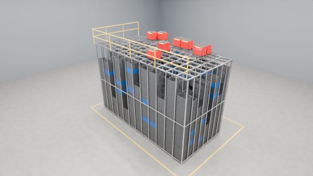
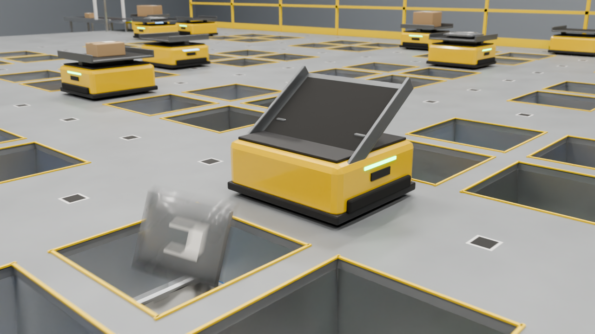
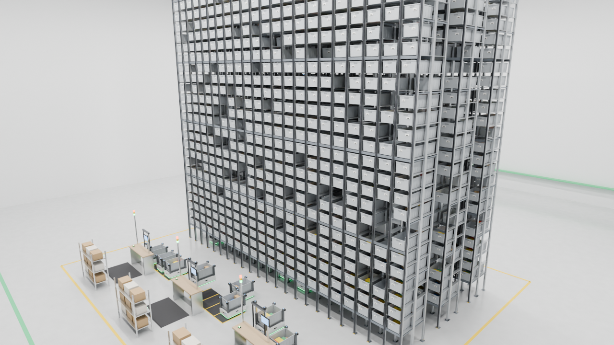
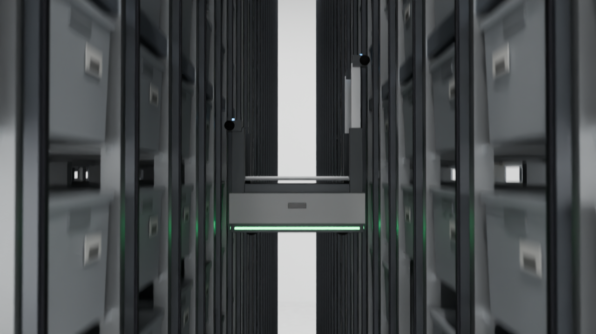
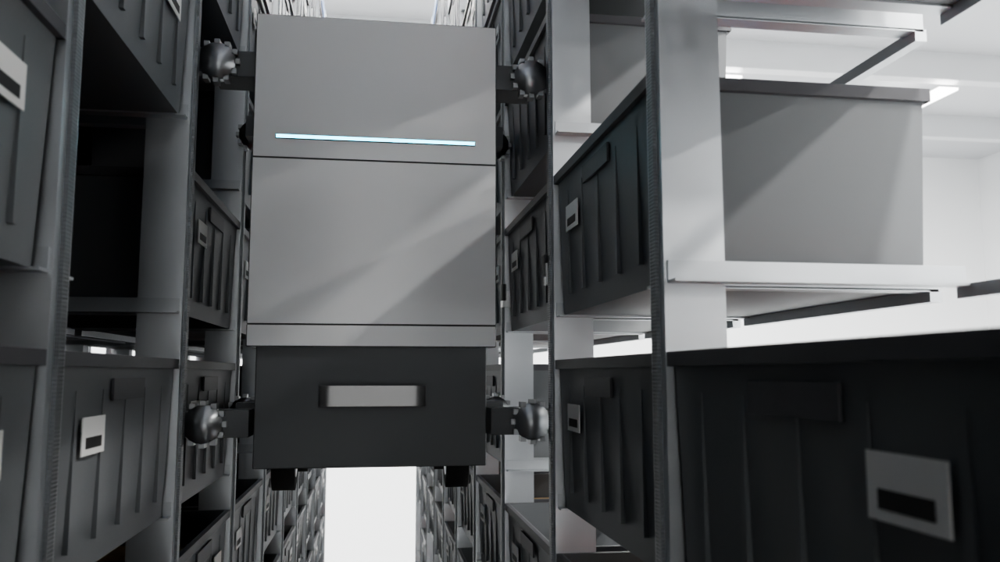
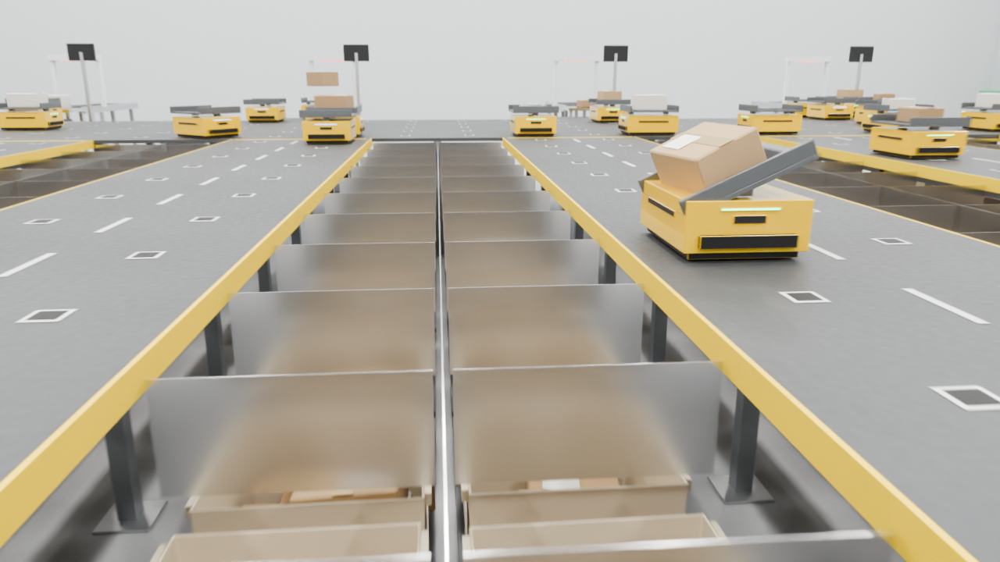
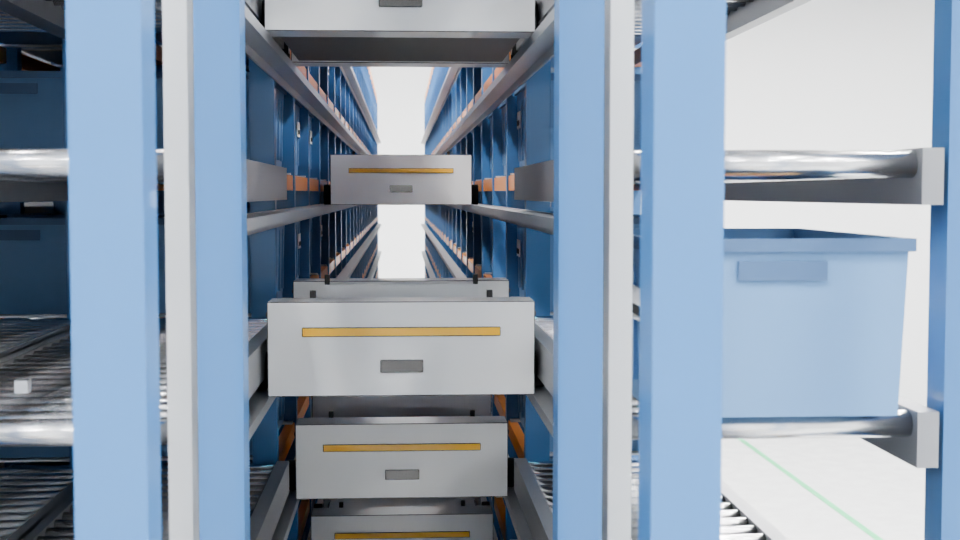
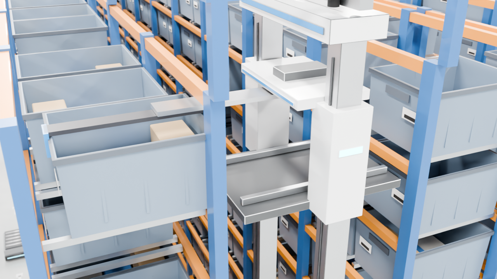
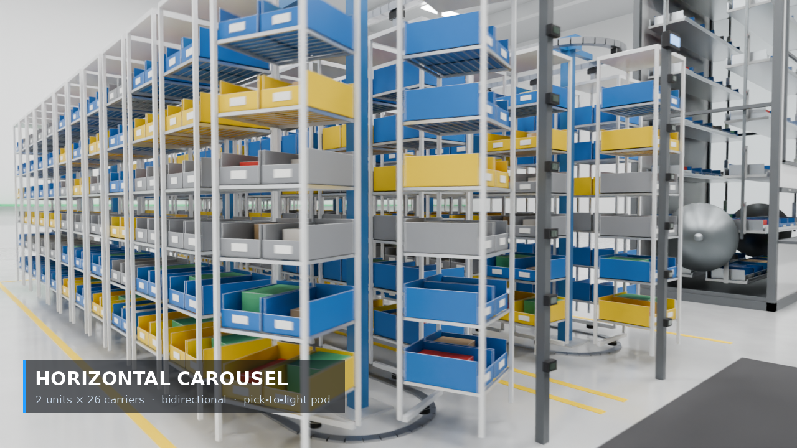
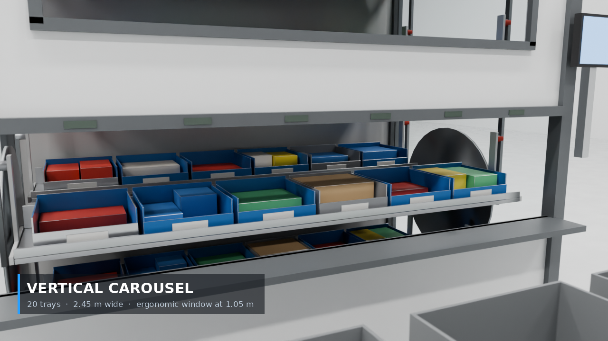

# AutoStore 시뮬레이션 — Claude × Blender × Unity 사실적 렌더링 테스트

AutoStore 방식 큐브 스토리지(그리드 + 적층 빈 + 상부 주행 로봇 + 포트)를 조사해 모델링하고, 같은 시뮬레이션 로직으로

- **Blender (Cycles)**: 사실적 재질·조명의 30초 애니메이션 영상
- **Unity 6 (URP)**: 실시간 시뮬레이션 실행 + 같은 카메라 동선의 30초 MP4 녹화

를 만드는 프로젝트입니다. 이 저장소 폴더 자체가 Unity 프로젝트입니다.



## 폴더 구성

| 경로 | 내용 |
|---|---|
| `Assets/AutoStore/Scripts/AutoStoreSim.cs` | 시뮬레이션 코어 (C#) |
| `Assets/AutoStore/Scripts/AutoStoreView.cs` | 장면 자동 구성, 재질, 조명, 후처리, HUD |
| `Assets/AutoStore/Scripts/CinematicCamera.cs` | 30초 카메라 동선 / 마우스 오비트 |
| `Assets/AutoStore/Scripts/MovieCapture.cs` | 30초 MP4 녹화 (에디터 내장 인코더, 추가 패키지 없음) |
| `Assets/AutoStore/Editor/AutoStoreMenu.cs` | `AutoStore` 메뉴, 씬 자동 생성 |
| `Assets/AutoStore/Resources/Models/*.fbx` | Blender에서 만든 로봇·빈·포트 모델 |
| `blender/autostore_blender.py` | Blender 모델·장면·애니메이션·렌더 스크립트 |
| `blender/trace.json` | 30초 애니메이션용 시뮬레이션 궤적 |
| `blender/out/` | FBX, GLB, `.blend`, 렌더 이미지 / 미리보기 영상 |
| `web/sim-core.js` | 시뮬레이션 코어 (JavaScript, C#과 같은 로직) |
| `tools/export_trace.js` | 시뮬레이션 → Blender 궤적 내보내기 |
| `docs/research.md` | AutoStore 조사 요약, 사용한 수치와 출처, 시뮬레이션 결과 |

## 1. 받기 (Windows)

```powershell
cd C:\Users\User\UnityProjects
git clone https://github.com/parksehoon1971/autostore-sim.git   # 처음 한 번 (폴더가 비어 있으면 그대로 들어감)
cd autostore-sim
git pull                                                         # 이후 업데이트
```

## 2. Unity에서 실행

1. Unity Hub → **Add → Add project from disk** → `C:\Users\User\UnityProjects\autostore-sim` 선택 (Unity **6000.6.8f1**, URP 17.6).
2. 처음 열면 `Assets/AutoStore/Scenes/AutoStoreSim.unity` 씬이 자동으로 만들어지고 열립니다. 안 열리면 메뉴 **애니메이션 → AutoStore → Open Simulation Scene**.
3. **Play** — 900초 워밍업 후 운영 중인 상태에서 시작합니다. 왼쪽 위 HUD에 처리량, 대기시간, 디깅 수, 가동률이 나오고, 속도 슬라이더와 카메라 전환(시네마틱 / 마우스 오비트)이 있습니다.
4. **30초 영상**: 메뉴 **애니메이션 → AutoStore → Record 30s Movie (MP4, 1920x1080)**. 고정 30fps로 렌더한 뒤 자동으로 멈추고 `Recordings/autostore_unity_30s.mp4`를 탐색기에서 보여줍니다.

시뮬레이션 파라미터(그리드 크기, 로봇 수, 포트 위치, 주문률, 속도 등)는 씬의 `AutoStore` 오브젝트 → `AutoStoreView` → `Config`에서 바꿉니다.

## 3. Blender에서 렌더

Blender 4.2 이상 (5.x 확인). 저장소 루트에서:

```powershell
# 장면 생성 + 정지 이미지 (450 프레임)
blender -b -P blender/autostore_blender.py -- --out blender/out --trace blender/trace.json --still 450 --gpu

# 30초 영상 (1920x1080, 30fps, GPU). ffmpeg가 PATH에 있으면 mp4로 합쳐짐
blender -b -P blender/autostore_blender.py -- --out blender/out --trace blender/trace.json --anim --gpu --res 1920x1080 --samples 128
```

- NVIDIA/AMD GPU가 없으면(예: Intel 내장 그래픽) Cycles는 CPU로 돌아 느립니다. 이때는 EEVEE를 쓰세요:
  `blender -b -P blender/autostore_blender.py -- --out blender/out --trace blender/trace.json --anim --engine eevee --samples 64 --res 1920x1080`
- ffmpeg가 없어도 Blender 내장 인코더로 `blender/out/autostore_30s.mp4`를 만듭니다. 프레임만 다시 합치려면 `--anim --encode-only`.
- `blender/out/autostore_scene.blend`를 GUI로 열어 카메라·재질을 직접 다듬을 수도 있습니다.
- `--anim`은 이미 렌더된 프레임을 건너뛰므로 중단 후 다시 실행하면 이어서 렌더합니다.
- 다른 시뮬레이션 장면을 원하면 궤적을 다시 만듭니다: `node tools/export_trace.js --robots 10 --seed 5`

## 모델 요약

- 그리드 12×8 셀, 330 mm 빈 최대 16단(약 1,190개), 포트 3개, 로봇 8대
- 로봇: 3.1 m/s, 0.8 m/s², 방향 전환 1.0 s, 그리퍼 1.6 m/s (AutoStore R5 공개 사양)
- 디깅: 위의 빈을 근처 스택으로 옮긴 뒤 목표 빈 인출, 피킹 후 빈은 가까운 스택 맨 위로 복귀
- 결과: 로봇 8대에서 약 200 빈/h, 디깅 3회/인출 — 자세한 내용은 [docs/research.md](docs/research.md)

치수·형상은 공개 자료 기반 근사이며 AutoStore 제품 도면이 아닙니다.

---

# Libiao(立镖) 3D 소터 — 같은 방식의 두 번째 장면

강철 플랫폼 위를 노란 소형 로봇 30대가 달리며, 투입대에서 소포를 받아 목적지 슈트 옆에서 트레이를 기울여 떨어뜨리고, 소포는 아래층 자루(슈트 96개)에 쌓입니다. 같은 Unity 프로젝트 안에 `Libiao` 메뉴로 들어 있습니다.



| 경로 | 내용 |
|---|---|
| `web/libiao-sim-core.js` | 소터 시뮬레이션 코어 (JavaScript) |
| `tools/export_libiao_trace.js` | 시뮬레이션 → Blender 궤적 `blender/libiao_trace.json` |
| `blender/libiao_blender.py` | Blender 모델·장면·애니메이션·렌더 스크립트 (Cycles, 절차적 PBR) |
| `blender/out/libiao/` | 로봇 FBX/GLB, 소포 FBX, 렌더 이미지·미리보기 영상 |
| `Assets/Libiao/Scripts/LibiaoSim.cs` | 시뮬레이션 코어 (C#, JS와 같은 로직) |
| `Assets/Libiao/Scripts/LibiaoView.cs` | 플랫폼·슈트·자루·투입대·로봇·소포·조명·후처리 자동 구성, HUD |
| `Assets/Libiao/Scripts/LibiaoCamera.cs` | Blender와 같은 30초 카메라 동선 / 마우스 오비트 |
| `Assets/Libiao/Scripts/LibiaoMovieCapture.cs` | 30초 MP4 녹화 (에디터 내장 인코더) |
| `Assets/Libiao/Editor/LibiaoMenu.cs` | `Libiao` 메뉴 |
| `docs/libiao-research.md` | 조사 요약, 출처, 가정한 수치, 시뮬레이션 결과 |

**Unity**: `git pull` 후 프로젝트를 열고 메뉴 **애니메이션 → Libiao → Open Sorter Scene** → **Play**. 30초 영상은 **애니메이션 → Libiao → Record 30s Movie (MP4, 1920x1080)** → `Recordings/libiao_unity_30s.mp4`.

**Blender** (저장소 루트에서):

```powershell
# 장면 생성 + 정지 이미지 (705 프레임 = 투하 장면)
blender -b -P blender/libiao_blender.py -- --out blender/out/libiao --trace blender/libiao_trace.json --still 705 --gpu

# 30초 영상 (1920x1080, 30fps, GPU). ffmpeg가 PATH에 있으면 libiao_30s.mp4 로 합쳐짐
blender -b -P blender/libiao_blender.py -- --out blender/out/libiao --trace blender/libiao_trace.json --anim --gpu --res 1920x1080 --samples 128

# 다른 시뮬레이션 장면: node tools/export_libiao_trace.js --robots 40 --seed 5
```

결과: 로봇 30대에서 약 2,600건/h (데크 140 m²). 치수·속도는 공개 자료가 없어 가정한 값이며 Libiao 제품 도면이 아닙니다. 자세한 내용은 [docs/libiao-research.md](docs/libiao-research.md).

---

# Rapyuta ASRS — 같은 방식의 세 번째 장면

빨간 GFRP 기둥과 검은 바닥 패널로 7층을 쌓고, 높이 80 mm 로봇 20대가 층마다 빈 아래를 달리며 빈을 들어 옮깁니다. 체인 리프트 5대로 층을 오가고, 안쪽 빈은 앞쪽 빈을 잠시 옮긴 뒤 꺼내며, 2층 앞 피킹 스테이션 2곳(빈 4개씩)으로 가져옵니다. 같은 Unity 프로젝트 안에 `Rapyuta` 메뉴로 들어 있습니다.


| 경로 | 내용 |
|---|---|
| `web/rapyuta-sim-core.js` | 시뮬레이션 코어 (JavaScript) |
| `tools/export_rapyuta_trace.js` | 시뮬레이션 → Blender 궤적 `blender/rapyuta_trace.json` |
| `blender/rapyuta_blender.py` | Blender 모델·장면·애니메이션·렌더 스크립트 (Cycles, 절차적 PBR) |
| `blender/out/rapyuta/` | 로봇·빈 FBX/GLB, 렌더 이미지 |
| `Assets/Rapyuta/Scripts/RapyutaSim.cs` | 시뮬레이션 코어 (C#, JS와 같은 결과) |
| `Assets/Rapyuta/Scripts/RapyutaView.cs` | 층 패널·기둥·리프트·스테이션·로봇·빈·조명·후처리 자동 구성, HUD |
| `Assets/Rapyuta/Scripts/RapyutaCamera.cs` | Blender와 같은 30초 카메라 동선 / 마우스 오비트 |
| `Assets/Rapyuta/Scripts/RapyutaMovieCapture.cs` | 30초 MP4 녹화 (에디터 내장 인코더) |
| `Assets/Rapyuta/Editor/RapyutaMenu.cs` | `Rapyuta` 메뉴 |
| `docs/rapyuta-research.md` | 조사 요약, 출처, 가정한 수치, 시뮬레이션 결과 |

**Unity**: `git pull` 후 프로젝트를 열고 메뉴 **애니메이션 → Rapyuta → Open ASRS Scene** → **Play**. 30초 영상은 **애니메이션 → Rapyuta → Record 30s Movie (MP4, 1920x1080)** → `Recordings/rapyuta_unity_30s.mp4`. 녹화는 Blender 궤적과 같은 시점(600초 워밍업 직후, seed 3)에서 시작해 같은 장면이 나옵니다.

**Blender** (저장소 루트에서):

```powershell
# 장면 생성 + 정지 이미지 (560 프레임 = 층 사이 통로)
blender -b -P blender/rapyuta_blender.py -- --out blender/out/rapyuta --trace blender/rapyuta_trace.json --still 560 --gpu

# 30초 영상 (1920x1080, 30fps, GPU). ffmpeg가 PATH에 있으면 rapyuta_30s.mp4 로 합쳐짐
blender -b -P blender/rapyuta_blender.py -- --out blender/out/rapyuta --trace blender/rapyuta_trace.json --anim --gpu --res 1920x1080 --samples 128

# 다른 시뮬레이션 장면: node tools/export_rapyuta_trace.js --robots 30 --seed 5  (카메라 동선은 seed 3 기준)
```

결과: 로봇 20대에서 약 430 빈/h, 출고 1건당 앞쪽 빈 치우기 약 0.2회. 층 높이 630 mm, 로봇 80 mm·2.5 m/s, 빈 650×440 mm는 공식 수치이고 셀 피치·리프트 속도 등은 가정입니다. Rapyuta 제품 도면이 아닙니다. 자세한 내용은 [docs/rapyuta-research.md](docs/rapyuta-research.md).

---

# HaiPick Climb — 같은 방식의 네 번째 장면

Hai Robotics의 HaiPick Climb처럼, 높이 11.7 m 표준 랙의 통로 쪽 면에 가이드 레일을 달고 로봇 18대가 레일을 잡고 올라가 토트를 꺼냅니다. 로봇은 토트를 실은 채 랙 밑으로 지나 앞쪽 작업대 3곳으로 달려가고, 작업대 레일을 조금 올라 토트를 허리 높이로 내민 뒤 가까운 빈 칸에 다시 넣습니다. 같은 Unity 프로젝트 안에 **애니메이션 → HaiPick** 메뉴로 들어 있습니다.





| 경로 | 내용 |
|---|---|
| `web/haipick-sim-core.js` | 시뮬레이션 코어 (JavaScript) |
| `tools/export_haipick_trace.js` | 시뮬레이션 → Blender 궤적 `blender/haipick_trace.json` |
| `blender/haipick_blender.py` | Blender 모델·장면·애니메이션·렌더 스크립트 (Cycles, 절차적 PBR) |
| `blender/out/haipick/` | 로봇·토트 FBX/GLB, 렌더 이미지 |
| `Assets/HaiPick/Scripts/HaiPickSim.cs` | 시뮬레이션 코어 (C#, JS와 같은 결과) |
| `Assets/HaiPick/Scripts/HaiPickView.cs` | 랙·가이드 레일·작업대·로봇·토트·조명·후처리 자동 구성, HUD |
| `Assets/HaiPick/Scripts/HaiPickCamera.cs` | Blender와 같은 30초 카메라 동선 / 마우스 오비트 |
| `Assets/HaiPick/Scripts/HaiPickMovieCapture.cs` | 30초 MP4 녹화 (에디터 내장 인코더) |
| `Assets/HaiPick/Editor/HaiPickMenu.cs` | `애니메이션 → HaiPick` 메뉴 |
| `docs/haipick-research.md` | 조사 요약, 출처, 가정한 수치, 시뮬레이션 결과 |

**Unity**: `git pull` 후 프로젝트를 열고 메뉴 **애니메이션 → HaiPick → Open Climb Scene** → **Play**. 30초 영상은 **애니메이션 → HaiPick → Record 30s Movie (MP4, 1920x1080)** → `Recordings/haipick_unity_30s.mp4`. 녹화는 Blender 궤적과 같은 시점(600초 워밍업 직후, seed 10)에서 시작해 같은 장면이 나옵니다.

**Blender** (저장소 루트에서):

```powershell
# 장면 생성 + 정지 이미지 (300 프레임 = 7.2 m 높이에서 토트 꺼내기)
blender -b -P blender/haipick_blender.py -- --out blender/out/haipick --trace blender/haipick_trace.json --still 300 --gpu

# 30초 영상 (1920x1080, 30fps, GPU). ffmpeg가 PATH에 있으면 haipick_30s.mp4 로 합쳐짐
blender -b -P blender/haipick_blender.py -- --out blender/out/haipick --trace blender/haipick_trace.json --anim --gpu --res 1920x1080 --samples 128

# 다른 시뮬레이션 장면: node tools/export_haipick_trace.js --robots 24 --seed 5  (카메라 동선은 seed 10 기준)
```

결과: 로봇 18대에서 시간당 약 640 토트, 리드타임 약 50초, 평균 등반 1.8 m. 처리 한계는 작업대 3곳에서 약 730 토트/h입니다. 높이 12 m, 통로 900 mm, 주행 4 m/s, 등반 1 m/s, 레일 한쪽 면·등반 팔 2개는 공식 수치이고 로봇·토트 치수, 칸 피치, 작업대 구조는 가정입니다. Hai Robotics 제품 도면이 아닙니다. 자세한 내용은 [docs/haipick-research.md](docs/haipick-research.md).

---

# Exotec Skypod — 같은 방식의 다섯 번째 장면

높이 9.8 m 랙 4줄 사이를 흰 로봇 20대가 바닥에서 최고 4 m/s로 달리다, 목표 칸에서 양옆 랙 기둥의 톱니를 잡고 수직으로 올라가 텔레스코픽 암으로 토트를 꺼냅니다. 토트를 싣고 내려와 앞쪽 피킹 스테이션 3곳으로 가져가고, 피킹이 끝나면 빈 자리에 다시 넣습니다. 같은 Unity 프로젝트 안에 **애니메이션 → Skypod** 메뉴로 들어 있습니다.



| 경로 | 내용 |
|---|---|
| `web/skypod-sim-core.js` | 시뮬레이션 코어 (JavaScript) |
| `tools/export_skypod_trace.js` | 시뮬레이션 → Blender 궤적 `blender/skypod_trace.json` |
| `blender/skypod_blender.py` | Blender 모델·장면·애니메이션·렌더 스크립트 (Cycles, 절차적 PBR) |
| `blender/out/skypod/` | 로봇·토트 FBX/GLB, 렌더 이미지 |
| `Assets/Skypod/Scripts/SkypodSim.cs` | 시뮬레이션 코어 (C#, JS와 같은 결과) |
| `Assets/Skypod/Scripts/SkypodView.cs` | 랙·스테이션·펜스·로봇·토트·조명·후처리 자동 구성, HUD |
| `Assets/Skypod/Scripts/SkypodCamera.cs` | Blender와 같은 30초 카메라 동선 / 마우스 오비트 |
| `Assets/Skypod/Scripts/SkypodMovieCapture.cs` | 30초 MP4 녹화 (에디터 내장 인코더) |
| `Assets/Skypod/Editor/SkypodMenu.cs` | `애니메이션 → Skypod` 메뉴 |
| `docs/skypod-research.md` | 조사 요약, 출처, 가정한 수치, 시뮬레이션 결과 |

**Unity**: `git pull` 후 프로젝트를 열고 메뉴 **애니메이션 → Skypod → Open Skypod Scene** → **Play**. 30초 영상은 **애니메이션 → Skypod → Record 30s Movie (MP4, 1920x1080)** → `Recordings/skypod_unity_30s.mp4`. 녹화는 Blender 궤적과 같은 시점(680초 워밍업 직후, seed 3)에서 시작해 같은 장면이 나옵니다.

**Blender** (저장소 루트에서):

```powershell
# 장면 생성 + 정지 이미지 (545 프레임 = 6.7 m 높이에서 토트 꺼내기)
blender -b -P blender/skypod_blender.py -- --out blender/out/skypod --trace blender/skypod_trace.json --still 545 --gpu

# 30초 영상 (1920x1080, 30fps, GPU). ffmpeg가 PATH에 있으면 skypod_30s.mp4 로 합쳐짐
blender -b -P blender/skypod_blender.py -- --out blender/out/skypod --trace blender/skypod_trace.json --anim --gpu --res 1920x1080 --samples 128

# GPU가 없으면 EEVEE: --anim --engine eevee --samples 16 --res 1280x720
# 다른 시뮬레이션 장면: node tools/export_skypod_trace.js --robots 30 --seed 5  (카메라 동선은 seed 3, warmup 680 기준)
```

결과: 로봇 20대에서 약 790 토트/h, 평균 리드타임 80초. 바닥 4 m/s, 등반 최대 14 m, 적재 30 kg, 토트 650×450 mm는 공개 수치이고 랙 칸 폭·단 간격·로봇 치수·등반 속도는 가정입니다. Exotec 제품 도면이 아닙니다. 자세한 내용은 [docs/skypod-research.md](docs/skypod-research.md).

---

# 공통: 깜빡임 제거 · 컷 카메라 · 모던 자막 (모든 장면)

`Assets/Common/Scripts/` 에 모든 장면이 같이 쓰는 코드가 있습니다.

| 파일 | 내용 |
|---|---|
| `MeshFix.cs` | Z-파이팅 자동 해소. 모델(FBX)과 코드로 만든 묶음 메쉬에서 재질을 면적 순으로 정렬해, 작은 재질(라벨·LED·손잡이·표시선)일수록 법선 방향으로 0.8 mm씩 밀어냄 → 같은 평면에 겹친 면이 번갈아 보이지 않음 |
| `ShotSequencer.cs` | 컷 기반 샷 구성 (경로 샷 / 움직이는 로봇을 따라가는 추적 샷), 카메라 near·far 및 녹화용 32비트 깊이 버퍼 |
| `CinematicRig.cs` | 장면 카메라 공통부 (샷 재생, DOF 초점, 컷 프레임 모션 블러 끄기, 마우스 오비트) |
| `CaptionOverlay.cs` | 설비명 타이틀 카드 · 오른쪽 위 설비 태그 · 샷 설명 자막 · 진행 바 · 시작/끝 페이드. 녹화 프레임에 후처리 뒤 합성 (맑은 고딕) |

- 깜빡임 원인과 조치: 모델 자동 검사에서 같은 평면에 겹친 면 발견 (Skypod 로봇 흰 패널/회색 섀시 약 0.3 m², Rapyuta 빈 손잡이/몸체, HaiPick 로봇, AutoStore 포트 신호등/기둥) → `MeshFix` 로 분리. 코드로 만든 얇은 표시선(Rapyuta 흰 격자선 1.2 mm, Libiao QR 마커 0.6 mm, 소포 테이프/라벨, HaiPick 작업대 노란 칸)을 두껍게. AutoStore 그리드 기둥 윗면과 레일 윗면이 같은 높이로 겹쳐 있던 것 수정. 카메라 near 0.02~0.05 m → 0.05~0.1 m, 녹화 깊이 버퍼 32비트.
- 샷 시점은 각 장면 시뮬레이션을 기본 설정으로 돌려 실제 동작(등반, 인출, 리프트, 투하 등) 시각에 맞췄습니다. 설정을 바꾸면 추적 샷은 같은 번호 로봇을 계속 따라갑니다.
- AutoStore 로봇: 상판에 흰 번호(01~08), 도장을 밝은 빨강으로.
- Blender 스크립트의 카메라(CAM_KEYS)는 바꾸지 않았습니다. 최종 영상은 Unity 녹화 메뉴를 쓰세요.

---

# Libiao T-Sort 핑거형 로봇 소터 — 같은 방식의 여섯 번째 장면

넓은 메인 데크에서 빗살처럼 뻗은 핑거 6개 위를 노란 로봇 30대가 달립니다. 왼쪽 투입 스테이션 4곳에서 작업자가 스캔한 소포를 받아 목적지 슈트 옆까지 가서 트레이를 기울이면, 소포가 핑거 사이 틈으로 떨어져 바닥의 슈트 통(168개)에 쌓입니다. 핑거는 나가는 차선과 돌아오는 차선 2차선이고 끝에서 U턴합니다. 같은 Unity 프로젝트 안에 **애니메이션 → T-Sorter** 메뉴로 들어 있습니다. 기존 Libiao 장면(격자형 데크 + 아래층 자루)과는 다른, 공식 T-Sort 솔루션 그림의 핑거형 플랫폼입니다.



| 경로 | 내용 |
|---|---|
| `web/tsorter-sim-core.js` | 시뮬레이션 코어 (JavaScript) |
| `tools/export_tsorter_trace.js` | 시뮬레이션 → Blender 궤적 `blender/tsorter_trace.json` |
| `blender/tsorter_blender.py` | Blender 모델·장면·애니메이션·렌더 스크립트 (Cycles, 절차적 PBR) |
| `blender/out/tsorter/` | 로봇·슈트 통·소포 FBX, 로봇 GLB, 렌더 이미지 |
| `Assets/TSorter/Scripts/TSorterSim.cs` | 시뮬레이션 코어 (C#, JS와 같은 결과) |
| `Assets/TSorter/Scripts/TSorterView.cs` | 데크·핑거·슈트·통·스테이션·충전 파일·로봇·소포·조명·후처리 자동 구성, HUD |
| `Assets/TSorter/Scripts/TSorterCamera.cs` | Blender와 같은 30초 카메라 동선 (트래킹·틈 안·크레인 샷) / 마우스 오비트 |
| `Assets/TSorter/Scripts/TSorterCaption.cs` | 장비 이름 캡션 (타이틀 → 장면별 챕터 → 엔드 카드), 녹화 프레임에 합성 |
| `Assets/TSorter/Scripts/TSorterMovieCapture.cs` | 30초 MP4 녹화 (에디터 내장 인코더) |
| `Assets/TSorter/Editor/TSorterMenu.cs` | `애니메이션 → T-Sorter` 메뉴 |
| `docs/tsorter-research.md` | 조사 요약, 출처, 가정한 수치, 시뮬레이션 결과 |

**Unity**: GitHub에서 PR을 머지한 뒤 `git pull`, 프로젝트를 열고 메뉴 **애니메이션 → T-Sorter → Open T-Sorter Scene** → **Play**. 30초 영상은 **애니메이션 → T-Sorter → Record 30s Movie (MP4, 1920x1080)** → `Recordings/tsorter_unity_30s.mp4`. 녹화는 Blender 궤적과 같은 시점(600초 워밍업 직후, seed 3)에서 시작합니다. 캡션은 씬의 `TSorterView` → `Show Caption` 으로 끌 수 있습니다.

---

# 셔틀랙 (다층 토트 셔틀 AS/RS) — 같은 방식의 장면

높이 6.5 m, 14단 랙 통로 3개에서 단마다 셔틀 1대(모두 42대)가 레일을 따라 최고 4 m/s로 달리며 텔레스코픽 암으로 토트를 꺼내 앞쪽 출고 버퍼에 내려놓습니다. 통로 앞 리프트가 토트를 1층 컨베이어로 내리고, 컨베이어가 피킹 스테이션으로 가져간 뒤 입고 리프트를 거쳐 다시 랙에 넣습니다. 특정 제조사 제품이 아닌 일반 구성이며 로고가 없습니다. 같은 Unity 프로젝트 안에 **애니메이션 → 셔틀랙** 메뉴로 들어 있습니다.



| 경로 | 내용 |
|---|---|
| `web/shuttle-sim-core.js` | 시뮬레이션 코어 (JavaScript) |
| `tools/export_shuttle_trace.js` | 시뮬레이션 → Blender 궤적 `blender/shuttle_trace.json` + 카메라 동선 `Assets/ShuttleRack/Resources/ShuttleCamera.json` |
| `blender/shuttle_blender.py` | Blender 모델·장면·애니메이션·렌더 스크립트 (Cycles, 절차적 PBR) |
| `blender/out/shuttle/` | 셔틀·리프트 캐리지·토트 FBX/GLB, 렌더 이미지 |
| `Assets/ShuttleRack/Scripts/ShuttleSim.cs` | 시뮬레이션 코어 (C#, JS와 같은 결과) |
| `Assets/ShuttleRack/Scripts/ShuttleView.cs` | 랙·레일·버퍼·리프트 탑·컨베이어·스테이션·셔틀·토트·조명·후처리 자동 구성, HUD |
| `Assets/ShuttleRack/Scripts/ShuttleCamera.cs` | Blender와 같은 30초 카메라 (토트 하나를 따라감) / 마우스 오비트 |
| `Assets/ShuttleRack/Scripts/ShuttleCaption.cs` | 장비 이름·단계 자막 (녹화 프레임에 합성) |
| `Assets/ShuttleRack/Scripts/ShuttleMovieCapture.cs` | 30초 MP4 녹화 (에디터 내장 인코더) |
| `Assets/ShuttleRack/Editor/ShuttleMenu.cs` | `애니메이션 → 셔틀랙` 메뉴 |
| `docs/shuttle-research.md` | 조사 요약, 출처, 가정한 수치, 시뮬레이션 결과, 영상 동선 |

**Unity**: `git pull` 후 프로젝트를 열고 메뉴 **애니메이션 → 셔틀랙 → Open Shuttle Rack Scene** → **Play**. 30초 영상은 **애니메이션 → 셔틀랙 → Record 30s Movie (MP4, 1920x1080)** → `Recordings/shuttlerack_unity_30s.mp4`. 녹화는 Blender 궤적과 같은 시점(1,200초 워밍업 직후, seed 3)에서 시작하고, 카메라가 10단 토트 하나를 셔틀 → 출고 버퍼 → 리프트 → 컨베이어 → 스테이션까지 따라갑니다. 장비 이름과 단계 자막이 영상에 들어갑니다.

---

# Libiao AirRob — 같은 방식의 장면 (랙 면 레일 로봇 + 바닥 이송 로봇)

통로 4개, 높이 약 6 m 랙 양쪽 면을 따라 AirRob 4대가 바닥·위 레일 위에서 수평 2 m/s, 수직 1 m/s로 동시에 움직이며 양방향 훅으로 토트를 당겨 옵니다. 꺼낸 토트를 그 칸 바로 아래까지 내려, 랙 맨 아래 터널에서 기다리는 바닥 로봇 위로 밀어 줍니다. 바닥 로봇 16대가 토트를 작업 스테이션 2곳으로 나르고, 피킹 뒤 같은 칸 아래로 돌아와 AirRob 에 돌려줍니다. 같은 Unity 프로젝트 안에 **애니메이션 → AirRob** 메뉴로 들어 있습니다.



| 경로 | 내용 |
|---|---|
| `web/airrob-sim-core.js` | 시뮬레이션 코어 (JavaScript) |
| `tools/export_airrob_trace.js` | 시뮬레이션 → Blender 궤적 `blender/airrob_trace.json` |
| `blender/airrob_blender.py` | Blender 모델·장면·애니메이션·렌더 스크립트 (Cycles, 절차적 PBR) |
| `blender/out/airrob/` | AirRob·바닥 로봇·토트 FBX/GLB, 렌더 이미지 |
| `Assets/AirRob/Scripts/AirRobSim.cs` | 시뮬레이션 코어 (C#, JS와 같은 결과) |
| `Assets/AirRob/Scripts/AirRobView.cs` | 랙·레일·스테이션·펜스·AirRob·바닥 로봇·토트·조명·후처리 자동 구성, HUD |
| `Assets/AirRob/Scripts/AirRobCamera.cs` | Blender와 같은 30초 카메라 동선 (동작 근접 샷) / 마우스 오비트 |
| `Assets/AirRob/Scripts/AirRobCaption.cs` | 장비명 캡션 오버레이 (영상에도 들어감) |
| `Assets/AirRob/Scripts/AirRobMovieCapture.cs` | 30초 MP4 녹화 (에디터 내장 인코더) |
| `Assets/AirRob/Editor/AirRobMenu.cs` | `애니메이션 → AirRob` 메뉴 |
| `docs/airrob-research.md` | 조사 요약, 출처, 가정한 수치, 시뮬레이션 결과 |

**Unity**: `git pull` 후 프로젝트를 열고 메뉴 **애니메이션 → AirRob → Open AirRob Scene** → **Play**. 30초 영상은 **애니메이션 → AirRob → Record 30s Movie (MP4, 1920x1080)** → `Recordings/airrob_unity_30s.mp4`. 녹화는 Blender 궤적과 같은 시점(1342초 워밍업 직후, seed 3)에서 시작해 같은 장면이 나옵니다.

---

# 캐러셀 (수평형 + 수직형) — 같은 방식의 여섯 번째 장면

한 장면에 두 가지 회전 선반을 나란히 놓았습니다. 왼쪽은 **수평형 캐러셀** 2대로 이루어진 피킹 포드입니다. 타원 궤도를 도는 6단 선반 캐리어 26개가 가까운 방향으로 돌아 목표 캐리어를 앞쪽 끝(피킹면)에 세우고, 작업자 한 명이 한 대에서 꺼내는 동안 다른 한 대는 다음 캐리어로 미리 돌아갑니다. 오른쪽은 **수직형 캐러셀**로, 높이 약 6.9 m 캐비닛 안에서 폭 2.45 m 트레이 20개가 위아래로 순환하며 목표 트레이를 허리 높이 작업창에 세웁니다. 두 장비 모두 피킹 라이트가 꺼낼 칸을, 풋 라이트가 넣을 주문 토트를 가리킵니다. 영상에는 장비 이름 자막이 들어가며, 같은 Unity 프로젝트 안에 **애니메이션 → 캐러셀** 메뉴로 들어 있습니다.





| 경로 | 내용 |
|---|---|
| `web/carousel-sim-core.js` | 시뮬레이션 코어 (JavaScript) |
| `tools/export_carousel_trace.js` | 시뮬레이션 → Blender 궤적 `blender/carousel_trace.json` |
| `blender/carousel_blender.py` | Blender 모델·장면·애니메이션·렌더 스크립트 (Cycles, 절차적 PBR, 자막 합성) |
| `Assets/Carousel/Scripts/CarouselSim.cs` | 시뮬레이션 코어 (C#, JS와 같은 결과) |
| `Assets/Carousel/Scripts/CarouselView.cs` | 궤도·캐비닛·캐리어·트레이·피킹 라이트·조명·후처리 자동 구성, HUD |
| `Assets/Carousel/Scripts/CarouselCamera.cs` | Blender와 같은 30초 카메라 동선 / 마우스 오비트 |
| `Assets/Carousel/Scripts/CarouselCaption.cs` | 장비 이름 자막 (후처리를 받지 않는 UI 전용 카메라, 녹화에 포함) |
| `Assets/Carousel/Scripts/CarouselMovieCapture.cs` | 30초 MP4 녹화 (에디터 내장 인코더) |
| `Assets/Carousel/Editor/CarouselMenu.cs` | `애니메이션 → 캐러셀` 메뉴 |
| `Assets/Carousel/Resources/CarouselModels/` | Blender에서 내보낸 캐리어 3종·트레이 2종 FBX (없으면 같은 치수의 기본 도형) |
| `docs/carousel-research.md` | 조사 요약, 출처, 가정한 수치, 시뮬레이션 결과 |

**Unity**: `git pull` 후 프로젝트를 열고 메뉴 **애니메이션 → 캐러셀 → Open Carousel Scene** → **Play**. 30초 영상은 **애니메이션 → 캐러셀 → Record 30s Movie (MP4, 1920x1080)** → `Recordings/carousel_unity_30s.mp4`. 녹화는 Blender 궤적과 같은 시점(300초 워밍업 직후, seed 22)에서 시작해 같은 장면이 나옵니다.

**Blender** (저장소 루트에서):

```powershell
# 장면 생성 + 정지 이미지
blender -b -P blender/tsorter_blender.py -- --out blender/out/tsorter --trace blender/tsorter_trace.json --still 520 --gpu

# 30초 영상 (1920x1080, 30fps). GPU가 없으면 --engine eevee --samples 16 --res 1280x720
blender -b -P blender/tsorter_blender.py -- --out blender/out/tsorter --trace blender/tsorter_trace.json --anim --gpu --res 1920x1080 --samples 128

# 다른 시뮬레이션 장면: node tools/export_tsorter_trace.js --robots 20 --seed 5  (카메라 동선은 seed 3, warmup 600 기준)
```

결과: 로봇 30대에서 시간당 약 2,150건 (공개 프로필 "2000 Parts per hour" 와 비슷한 규모). 핑거형 플랫폼 구성, 투입 스테이션 수동 투입 + 자동 스캔, 로봇 480×380×230 mm는 공개 자료이고 셀 피치·데크 높이·핑거 길이·속도·슈트 통 크기는 가정입니다. Libiao 제품 도면이 아닙니다. 자세한 내용은 [docs/tsorter-research.md](docs/tsorter-research.md).

---

# 장면 생성 + 정지 이미지 (400 = 통로 입구, 470 = 리프트, 700 = 스테이션)
blender -b -P blender/shuttle_blender.py -- --out blender/out/shuttle --trace blender/shuttle_trace.json --still 400,470,700

# 30초 영상 (GPU가 없으면 EEVEE: --engine eevee --samples 16 --res 1280x720)
blender -b -P blender/shuttle_blender.py -- --out blender/out/shuttle --trace blender/shuttle_trace.json --anim --gpu --res 1920x1080 --samples 128

# 다른 시뮬레이션 장면: node tools/export_shuttle_trace.js --seed 5 --warmup 900  (카메라는 새 주인공 토트에 맞춰 다시 계산됨)
```

결과: 셔틀 42대, 리프트 6대, 스테이션 3곳에서 약 1,800 토트/h, 평균 리드타임 32초. 병목은 리프트(가동률 73%)이고 셔틀 가동률은 19%입니다. 셔틀 4 m/s·2 m/s², 토트 600×400 mm는 공개 자료의 일반적인 값이고 리프트 속도·단 간격·버퍼 길이 등은 가정입니다. 자세한 내용은 [docs/shuttle-research.md](docs/shuttle-research.md).

---

# 장면 생성 + 정지 이미지 (360 프레임 = 맨 위 단에서 훅으로 토트 당기기)
blender -b -P blender/airrob_blender.py -- --out blender/out/airrob --trace blender/airrob_trace.json --still 360

# 30초 영상 (GPU 권장). GPU가 없으면 --engine eevee --samples 16 --res 1280x720
blender -b -P blender/airrob_blender.py -- --out blender/out/airrob --trace blender/airrob_trace.json --anim --gpu --res 1920x1080 --samples 128

# 다른 시뮬레이션 장면: node tools/export_airrob_trace.js --bots 12 --seed 5  (카메라 동선은 seed 3, warmup 1342 기준)
```

결과: 바닥 로봇 16대, 주문 360 /h 에서 약 320 토트/h, 평균 리드타임 약 190초, AirRob 가동률 72%. 통로 4개에서 약 380 토트/h가 한계이고 병목은 AirRob 입니다. AirRob 폭 764 mm·깊이 820 mm, 수평 2 m/s·수직 1 m/s, 당기기·밀기 4.5 s, 토트 530×410 mm, 통로 850 mm는 공개 수치이고 마스트·훅 형상, 바닥 로봇, 단 간격, 색은 가정입니다. Libiao 제품 도면이 아닙니다. 자세한 내용은 [docs/airrob-research.md](docs/airrob-research.md).

---

# 장면 생성 + 정지 이미지 (181 프레임 = 수평형 피킹면, 586 프레임 = 수직형 작업창)
blender -b -P blender/carousel_blender.py -- --out blender/out/carousel --trace blender/carousel_trace.json --still 181,586 --gpu

# 30초 영상 (1920x1080, 30fps, GPU). ffmpeg가 PATH에 있으면 carousel_30s.mp4 로 합쳐짐. 자막은 Pillow가 있을 때 PNG에 합성
blender -b -P blender/carousel_blender.py -- --out blender/out/carousel --trace blender/carousel_trace.json --anim --gpu --res 1920x1080 --samples 128

# GPU가 없으면 EEVEE: --anim --engine eevee --samples 16 --res 1280x720
# 다른 시뮬레이션 장면: node tools/export_carousel_trace.js --seed 5  (카메라 동선은 seed 22, warmup 300 기준)
```

결과 (seed 1~3 평균, 1시간): 수평형 포드 약 570 줄/h (리드타임 119초, 작업자 가동률 63%, 공개 수치 "최대 550 줄/h"와 같은 수준), 수직형 약 320 줄/h (0.20 m/s 기준 상한에 가까움). 회전 속도·캐리어 치수·피킹 시간은 공개 카탈로그의 일반적인 범위에서 잡은 가정이며 특정 제조사 도면이 아닙니다. 자세한 내용은 [docs/carousel-research.md](docs/carousel-research.md).
