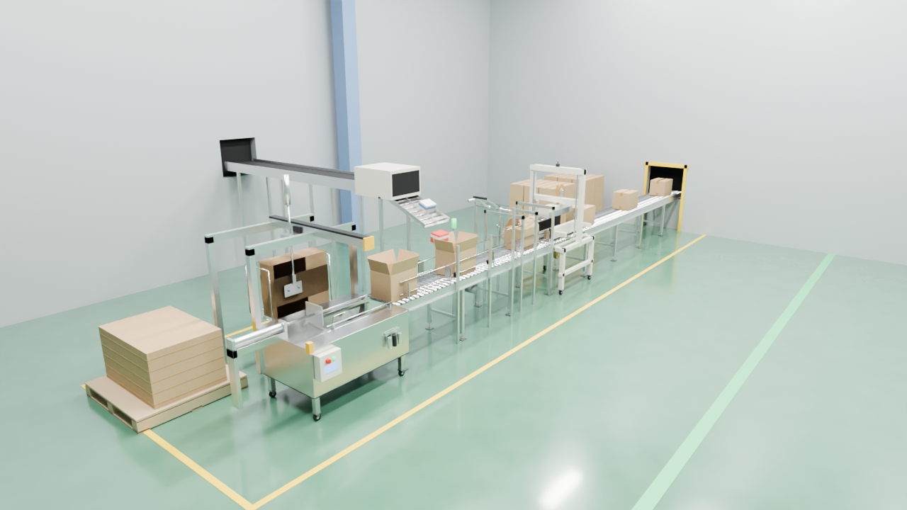

# 제함·봉함 라인 — 조사 요약과 모델링 가정

반자동 제함기(박스 세우기) → 롤러 컨베이어(상품 충전, 상부 날개 접기) → 반자동 봉함기(상하 테이핑)로 이어지는 박스 포장 라인입니다.
요청하신 "듀펙장원기계"는 공식 홈페이지가 **㈜듀팩코리아 (Dew Pack, dewpack.co.kr)** 로 연결되는 업체로 보고, 그 사이트의 제품 사진과 사양을 참고했습니다.
로고·상표·제품명 표기는 장면에 넣지 않았고, 사진을 보고 일반적인 형태로 만든 모델입니다. 제조사 도면이 아닙니다.



## 사용법

다른 장비 작업과 충돌하지 않도록 README 는 건드리지 않고 이 문서에 정리했습니다.

| 경로 | 내용 |
|---|---|
| `blender/caseline_kinematics.py` | 동작 정의 (박스 경로, 펼침·날개 각, 테이프, 상품, 기계 가동부) |
| `blender/caseline_blender.py` | Blender 모델·장면·애니메이션·렌더 (Cycles, 절차적 PBR), 설비 FBX/GLB 내보내기 |
| `blender/out/caseline/` | 설비 FBX/GLB, 렌더 스틸 |
| `tools/caseline_dump.py` | Python ↔ C# 동작 값 비교용 덤프 |
| `Assets/CaseLine/Scripts/CaseLineKinematics.cs` | 동작 정의 (C#, Python 과 같은 식) |
| `Assets/CaseLine/Scripts/CaseLineView.cs` | 설비 FBX 로드·정렬, 박스·상품·테이프·건물·조명·후처리 구성, HUD |
| `Assets/CaseLine/Scripts/CaseLineCamera.cs` | Blender 와 같은 30초 카메라 동선 / 마우스 오비트 |
| `Assets/CaseLine/Scripts/CaseLineMovieCapture.cs` | 30초 MP4 녹화 (에디터 내장 인코더) |
| `Assets/CaseLine/Editor/CaseLineMenu.cs` | `애니메이션 → 제함·봉함 라인` 메뉴 |
| `Assets/CaseLine/Resources/CaseLineModels/caseline_equipment.fbx` | Blender 에서 만든 설비 모델 |

**Unity**: GitHub 에서 PR 을 merge 한 뒤 `git pull`, 프로젝트를 열고 메뉴 **애니메이션 → 제함·봉함 라인 → Open Scene** → **Play**.
30초 영상은 **애니메이션 → 제함·봉함 라인 → Record 30s Movie (MP4, 1920x1080)** → `Recordings/caseline_unity_30s.mp4`.
HUD 에서 속도와 카메라(시네마틱 / 마우스 오비트)를 바꿀 수 있습니다.

**Blender** (저장소 루트에서):

```powershell
# 장면 생성 + 정지 이미지 (+ Unity 용 FBX 다시 내보내기)
blender -b -P blender/caseline_blender.py -- --out blender/out/caseline --still 1,196,376,556,706
# 30초 영상: GPU 가 있으면 Cycles, 없으면 EEVEE
blender -b -P blender/caseline_blender.py -- --out blender/out/caseline --anim --gpu --res 1920x1080 --samples 128
blender -b -P blender/caseline_blender.py -- --out blender/out/caseline --anim --engine eevee --samples 16 --res 1280x720
```

FBX 를 다시 만들었으면 `blender/out/caseline/caseline_equipment.fbx` 를 `Assets/CaseLine/Resources/CaseLineModels/` 로 복사합니다.

## 참고한 제품 (공개 자료)

| 항목 | 반자동 제함기 (사이트 표기 DP-501, "Semi auto box former") | 반자동 테이핑기 (DP-401, "I type taping m/c standard type") |
|---|---|---|
| 동작 | 작업자가 박스를 펼쳐(성형) 올려 놓으면 자동으로 아래 날개를 접음. 테이핑기와 함께 써서 효율을 높이는 기종 | 상부 날개를 접어 밀어 넣으면 상·하 동시 테이핑 |
| 기계 크기 | W800 × H600 × L1600 mm | W890 × H1780 × L1000 mm |
| 박스 크기 | W150~500, H100~500, L150~600 mm | W120~500, H120~500, L170~ 제한 없음 |
| 능력 | 최대 700 box/h | 최대 1,400 box/h |
| 구동 | 공압 실린더 (push type) | 사이드 벨트, 테이프 50 mm (옵션 75/80/100) |
| 전원 | 압축 공기 | 단상 220 V / 3상 380 V, 60 Hz |
| 외관 (사진) | 스테인리스 몸체, 캐스터 다리, 뒤쪽 와이어 매거진(블랭크를 세워 꽂음), 모서리 노란 캡, 에어 유닛 | 아이보리 도장 프레임, 테이프 헤드 위치에 문형 기둥 2개, 위 헤드 높이 조절, 좌우 사이드 벨트, 위·아래 테이프 롤, 캐스터, 앞뒤 롤러 테이블 |

출처: [듀팩코리아 박스제함기](http://www.dewpack.co.kr/gnuboard4/bbs/board.php?bo_table=p6&sca=%EB%B0%98%EC%9E%90%EB%8F%99%20%EC%A0%9C%ED%95%A8%EA%B8%B0),
[듀팩코리아 박스테이핑기](http://www.dewpack.co.kr/gnuboard4/bbs/board.php?bo_table=p7&sca=%EB%B0%98%EC%9E%90%EB%8F%99%ED%85%8C%EC%9D%B4%ED%95%91%EA%B8%B0),
[코머신 업체 소개](https://www.komachine.com/ko/companies/dew-pack-machinery/products) (공식 홈페이지 링크 확인).

## 이 모델의 가정

| 항목 | 값 | 비고 |
|---|---|---|
| 박스 | RSC(A형) 400 × 300 × 300 mm, 날개 150 mm, 골판지 4 mm | 두 기계 사양 범위 안 |
| 간격 | 5 s 마다 1박스 (720 box/h) | 제함기 최대 700 box/h 에 맞춤 |
| 작업 높이 | 0.75 m (제함기 베드 = 컨베이어 = 봉함기 롤러 상면) | 가정 |
| 블랭크 집기 | 작업자 대신 흡착 암이 매거진 맨 앞 블랭크의 **앞면(제함기 쪽 장변)** 에 컵을 대고 (4.55~5.0 s 접근, 면에서 정지), 0.2 m 들어 올려 베드 쪽으로 옮기며 몸통을 펼침 (0.9~1.5 s), 베드에 내려 놓음 (1.5~1.9 s) | 반자동 기계의 사람 동작을 장치로 바꿈. 펼치는 동안 잡은 면은 x 가 그대로 |
| 아래 날개 | 단변 날개를 개구부 아래 킥커가 접음 (1.95~2.3 s), 암이 놓고 빠진 뒤 (2.3~2.5 s) 푸셔가 2.45 s 에 출발해 1.0 m/s² 로 컨베이어 속도까지 밀며 장변 날개를 플로가 접음. 푸셔는 0.24 m 에서 멈추고 박스는 롤러가 이어 받음 | 박스 속도가 끊기지 않게 푸셔 → 롤러 인계 |
| 컨베이어 | 구동 롤러 Ø50 mm, 피치 75 mm, 0.35 m/s (21 m/min), 가감속 0.8 m/s² | 가정 |
| 충전 | x = 1.9 m 에서 정지 (8.2 s), 2줄 중력 슈트로 상품 단상자 185 × 135 × 120 mm 8개(2 × 2 × 2단) 투입 (7.7~10.1 s, 0.25 s 간격). 슈트 위는 등가속, 끝에서는 그 속도로 포물선 낙하 | 뒤 벽에서 들어오는 고가 벨트로 공급 |
| 상부 날개 접기 | 앞 단변: 중앙 레일 (x 2.78 m 에서 윗면 위 100 → 14 mm 로 내려와 3.95 m 까지), 뒤 단변: 킥커 팔 (x 2.70 m 축, 팔 0.38 m, 끝 롤러가 날개를 따라 누름), 장변: 플로 레일 (x 3.25~3.80 m) | 날개 각은 레일·롤러와 닿는 점에서 계산 (날개가 장치를 뚫지 않음) |
| 봉함기 | x 3.80~4.80 m, 테이프 헤드 x 4.30 m (위·아래), 사이드 벨트 속도 = 컨베이어 속도 | 테이프 폭 48 mm, 앞뒤 탭 60 mm |
| 출구 | 롤러 컨베이어로 칸막이 벽 개구부(x 8.8 m)를 지나 다음 공정으로 | 가정 |

박스 하나의 일생: 매거진 대기 (−5~0 s) → 집기·펼침 (0~1.9 s) → 아래 날개·푸셔 (1.95~3.0 s) → 충전 위치 이동 (~8.2 s) → 충전 (7.7~10.6 s) → 상부 날개 접기 (앞 12.7 s, 뒤 12.9~13.2 s, 장변 14.7~16.5 s) → 테이핑 (약 17.1~18.2 s) → 출구 (약 32.6 s 에 벽 너머로 사라짐).

## 구현 메모

- 동작 식은 `blender/caseline_kinematics.py` 와 `Assets/CaseLine/Scripts/CaseLineKinematics.cs` 두 곳에 같은 식으로 있습니다. 같은 시각을 넣어 비교한 결과 최대 차이 1e-6 (소수점 6자리 반올림) 입니다.
  비교 방법: `python3 tools/caseline_dump.py > py.txt` 와 같은 형식으로 C# 쪽 값을 출력하는 작은 콘솔 프로그램(mono `mcs`)을 만들어 비교합니다.
- 박스는 벽 4장 + 날개 8장 판으로 만들고, 몸통 펼침 각(평행사변형)과 날개 접힘 각으로 각 판의 위치·방향을 매 프레임 계산합니다. 장변 날개는 바깥, 단변 날개는 안쪽에 겹칩니다.
- 장면 상태는 5 s 주기라 0 s 와 30 s 장면이 같습니다 (30초 영상이 자연스럽게 반복됨).
- Unity 는 설비를 FBX 하나(`caseline_equipment.fbx`)로 불러오고, 그 안의 표지(`Marker_O/X/Y/Z`)로 축과 단위를 맞춘 뒤 `Pusher`, `PickArm`, `PickCarriage`, `Kicker`, `Roller_*` 를 이름으로 찾아 움직입니다. 박스·상품·테이프·건물은 코드로 만듭니다.

## 렌더

- 클라우드 CPU (Cycles, 1280×720, 64 spp, 모션 블러) 스틸 5장: `blender/out/caseline/caseline_still_*.png`, `docs/images/caseline_*.png`.
- 사용자 PC 에는 독립 GPU 가 없어 30초 Cycles 영상은 현실적이지 않습니다 (CPU 약 8분/프레임). 최종 영상은 Unity 메뉴 **애니메이션 → 제함·봉함 라인 → Record 30s Movie** 로 만듭니다.
  Blender 로 굳이 만들려면 EEVEE: `blender -b -P blender/caseline_blender.py -- --out blender/out/caseline --anim --engine eevee --samples 16 --res 1280x720`.
